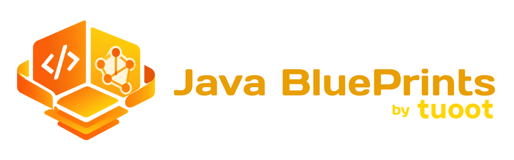
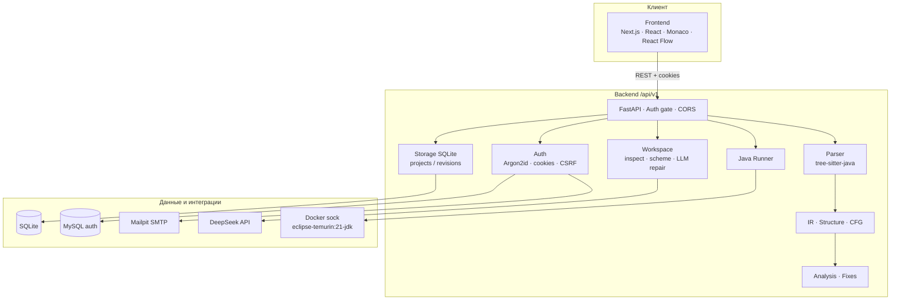

<p align="center">
  
</p>

<p align="center">
  <strong>Java Blueprints - визуальная среда программирования</strong>
</p>

<p align="center">
  Веб-инструмент для разбора Java-кода, построения модульной логической схемы,<br />
  диагностики, безопасных правок и проверки поведения в изолированных Docker-контейнерах JDK 21.<br />
  Кейс AXENIX: путь <em>Java ↔ блок-схема</em> с контролем сохранения результата.
</p>

<p align="center">
  <a href="http://176.124.223.68:8080/"><strong>🌐 Web-сайт проекта</strong></a>
</p>

---

## О проекте

**Java Blueprints** - решение кейса AXENIX «Визуальная среда программирования». Идея кейса: команда делает веб-инструмент, который понимает программу и как **код**, и как **граф**, помогает улучшить ее и **доказывает**, что поведение сохранилось.

Пользовательский путь из ТЗ:

1. Загрузить `.java`
2. Разобрать код
3. Построить граф / модульную схему
4. Исследовать и править
5. Собрать Java
6. Запустить и сравнить поведение

В репозитории реализован стек **Frontend (Next.js) + Backend (FastAPI)** с границей REST API `/api/v1`. Frontend отвечает за IDE-интерфейс, черновики и layout схемы; Backend - за разбор tree-sitter-java, IR/CFG, диагностику, хранение ревизий, LLM-ремонт и прогон поведенческих тестов в эфемерных контейнерах `eclipse-temurin:21-jdk`.

Канонический артефакт - текст Java-исходника конкретной ревизии. AST, IR и CFG - производные структуры. Смысловые правки идут через проверенные патчи и повторный разбор, а не через «перестановку картинок» на схеме.

Подробности: [`source/docs/ARCHITECTURE.md`](source/docs/ARCHITECTURE.md), [`source/docs/JAVA_SUPPORT.md`](source/docs/JAVA_SUPPORT.md), кейс: [`source/docs/axenix_case.pdf`](source/docs/axenix_case.pdf).

---

## Фишки проекта

- **Модульная логическая схема** на React Flow: разбор Java → блоки, связи, палитра шаблонов, полноэкранный режим
- **Monaco-редактор** с маркерами диагностики и синхронизацией с Backend
- **Честный разбор** через tree-sitter-java (без фиктивного CFG «из воздуха»)
- **Статический анализ**: недостижимый код, пустые блоки, эвристика сложности, быстрые точечные фиксы
- **LLM-ремонт** (DeepSeek): оптимизация / декомпозиция, сравнение кода и схем до/после
- **Проверка поведения**: два эфемерных Docker JDK-контейнера (исходный и восстановленный код), без host-fallback
- **Проводник проекта**, сохранение локально / экспорт, темы интерфейса
- **Auth**: регистрация, подтверждение email, сессии (httpOnly + CSRF), кабинет; MySQL + Mailpit в Docker-стеке
- **Полный compose**: MySQL, Mailpit, Backend, Frontend - один `docker compose up --build`

---

## О команде

| Участник | Telegram | Роль |
| --- | --- | --- |
| Александр Пропастин | [@propastin](https://t.me/propastin) | Teamleader, Frontend, API |
| Станислав Шуть | [@Stasechka1408](https://t.me/Stasechka1408) | Backend, API, Идеи |
| Никита Бакай | [@XCLLNT](https://t.me/XCLLNT) | QA-Tester, Pentesting |

---

## Архитектура проекта



**Уровни визуализации (как в архитектуре MVP):**

1. Дерево проекта - файлы, классы, методы  
2. Граф / модульная схема выбранного метода или логики  
3. Инспектор блока - свойства и привязка к фрагменту исходника  

**Основные группы API** (контракт: [`source/contracts/openapi.json`](source/contracts/openapi.json)):

| Группа | Примеры путей |
| --- | --- |
| Health | `GET /api/v1/health` |
| Parser / Structure / Graph / Analysis | `/parser/parse`, `/structure/build`, `/graph/build`, `/analysis/analyze` |
| Fixes / Transform | `/fixes/apply`, `/transform/generate` |
| Projects | `/projects`, `/projects/{id}/source` |
| Workspace | `/workspace/inspect`, `/generate-from-scheme`, `/repair-with-llm`, `/apply-logic-fix` |
| Auth | `/auth/register`, `/login`, `/logout`, `/me`, password-reset, … |

Документация API при локальном Backend: `http://127.0.0.1:8000/api/v1/docs`.

---

## Стек технологий

| Слой | Технологии |
| --- | --- |
| Frontend | Next.js 15, React 19, TypeScript, Tailwind CSS 4, Monaco Editor, `@xyflow/react`, Vitest |
| Backend | Python 3.12+, FastAPI, Pydantic v2, Uvicorn, tree-sitter / tree-sitter-java |
| Auth / mail | Argon2id, PyMySQL, Mailpit (SMTP в compose) |
| Данные | SQLite (проекты/ревизии), MySQL 8.4 (пользователи/сессии в Docker) |
| Исполнение Java | Docker, образ `eclipse-temurin:21-jdk`, лимиты CPU/RAM/PIDs |
| LLM | DeepSeek API (`LLM_*`, файл `api` / `LLM_API_KEY`) |
| Инфра | Docker Compose, OpenAPI-контракт в `contracts/` |
| Качество | pytest, Ruff, mypy, ESLint, Prettier, `scripts/check.ps1` |

---

## Требования

- **Python 3.12+** и [uv](https://docs.astral.sh/uv/)
- **Node.js 20+ LTS** и npm
- **Docker** (на хосте Backend) - для сравнения поведения после LLM; без Docker соответствующие тесты пропускаются (`skipped`)
- JDK на хосте **не нужен**: компиляция и запуск пользовательского Java только в эфемерных контейнерах
- Один раз заранее: `docker pull eclipse-temurin:21-jdk`

Обязательный Java-scope кейса и расширенный уровень: [`source/docs/JAVA_SUPPORT.md`](source/docs/JAVA_SUPPORT.md).  
Фикстуры: `source/fixtures/java/tz_java_lang_io_collections.java`, `source/fixtures/java/tz_advanced_java.java`.

---

## Установка и запуск (локально)

Нужны **два терминала**. Пути ниже - от корня этого репозитория.

### Backend

```powershell
cd backend
copy .env.example .env
uv sync --locked
uv run python -m app
```

- API: `http://127.0.0.1:8000`
- Health: `Invoke-RestMethod http://127.0.0.1:8000/api/v1/health`
- Swagger: `http://127.0.0.1:8000/api/v1/docs`

Для auth без Mailpit локально в `backend/.env`: `AUTH_STORE=memory` и `AUTH_DEV_AUTO_VERIFY_EMAIL=true`.

### Frontend

```powershell
cd frontend
copy .env.example .env.local
npm install
npm run dev
```

Откройте `http://localhost:3000`. В status bar должно быть «Backend доступен».

### LLM-ключ

Положите DeepSeek API Key в файл `api` в корне (шаблон: `api.example`) или задайте `LLM_API_KEY` в `backend/.env`. Файл `api` в git не коммитится. Ключи: https://platform.deepseek.com/api_keys

---

## Запуск и деплой

### Docker Compose (полный стек)

```powershell
copy .env.example .env
if (-not (Test-Path api)) { copy api.example api }
docker pull eclipse-temurin:21-jdk
docker compose up --build -d
```

| Сервис | Адрес по умолчанию |
| --- | --- |
| UI | http://127.0.0.1:3000 |
| API | http://127.0.0.1:8000 |
| Mailpit UI | http://127.0.0.1:8025 |
| MySQL | `127.0.0.1:3306` |

Остановка: `docker compose down`  
Логи: `docker compose logs -f backend frontend`  
Только Backend: `docker compose up --build backend`

В compose Backend монтирует `docker.sock` (одноразовый chmod для uid приложения) и volume `jb-java-work` для эфемерных JDK-контейнеров.

### Опубликованный Web-сайт

Рабочий стенд проекта:

**http://176.124.223.68:8080/**

---

## Как пользоваться

1. Откройте `.java` файл, папку проекта или введите код в редакторе.
2. Нажмите **Разобрать и проанализировать**.
3. Backend строит дерево/схему, статический анализ и (при наличии ключа) LLM-ревью.
4. Диагностика - в правой панели; точечные патчи - **Исправить**.
5. **Исправить ошибки через LLM** - сравнение кода и схем, toast с метриками; поведенческие тесты в двух Docker JDK-контейнерах.
6. Крупные файлы (>1000 строк): в LLM уходит контур + hotspots, ответ может быть точечными `replacements`.
7. Панели растягиваются мышью; схема - на весь экран; доступна генерация/сохранение схемы → код.
8. **Войти** в шапке - регистрация, кабинет, смена пароля (запросы с `credentials: include` и `X-CSRF-Token`).
9. Лимит исходника: `.java`, до 4 МиБ (`MAX_JAVA_SOURCE_BYTES`).
10. Лог Backend: `source/backend/var/logs/java_blueprints.log` (в Docker: `/data/logs`).

---

## Структура репозитория

```text
source/
  ├── backend/           # FastAPI: parser, IR, graph, analysis, auth, LLM, runner
  ├── frontend/          # Next.js IDE: редактор, схема, диагностика, auth UI
  ├── contracts/         # openapi.json - зафиксированный контракт API
  ├── docs/              # архитектура, milestone, Java support, кейс AXENIX, логотип
  ├── fixtures/java/     # эталонные и граничные Java-фикстуры
  ├── scripts/           # check.ps1 - единый прогон проверок
  ├── compose.yaml       # MySQL + Mailpit + Backend + Frontend
  ├── api.example        # шаблон ключа LLM (реальный api не в git)
  └── README.md
```

---

## Проверки качества и ограничения

### Проверки

```powershell
powershell -ExecutionPolicy Bypass -File source\scripts\check.ps1
```

Или вручную:

```powershell
cd backend
uv run pytest
uv run python -m app.openapi_export --check

cd ..\frontend
npm run typecheck
npm test
```

### Границы (как в docs, без приукрашивания)

- tree-sitter дает синтаксическое дерево, а не полную семантику JVM / javac
- часть CFG (например `do` / for-each / try) может быть `partial`
- оценки сложности - эвристики, не математическое доказательство Big O
- анонимные классы и ряд конструкций могут помечаться как `unsupported`
- Docker-песочница снижает риск, но не дает абсолютной изоляции на публичном shared-хосте
- без ключа LLM ремонт через модель недоступен; без Docker - нет прогона поведения в контейнерах

### Типовые проблемы

| Симптом | Что проверить |
| --- | --- |
| Backend недоступен | Запущен ли Backend, верный ли `NEXT_PUBLIC_API_BASE_URL` |
| CORS error | Origin есть в `CORS_ALLOWED_ORIGINS` |
| 413 при разборе | Исходник больше `MAX_JAVA_SOURCE_BYTES` |
| LLM недоступен | Файл `api` или `LLM_API_KEY`, перезапуск Backend |
| Docker: `api` стал каталогом | Удалите каталог `api`, создайте файл из `api.example` до `compose up` |

---

## Лицензия и ссылки

- Лицензия: [MIT](LICENSE)
- Демо: [http://176.124.223.68:8080/](http://176.124.223.68:8080/)
- Архитектура: [source/docs/ARCHITECTURE.md](source/docs/ARCHITECTURE.md)
- Поддержка Java: [source/docs/JAVA_SUPPORT.md](source/docs/JAVA_SUPPORT.md)
- Кейс AXENIX: [source/docs/axenix_case.pdf](source/docs/axenix_case.pdf)
